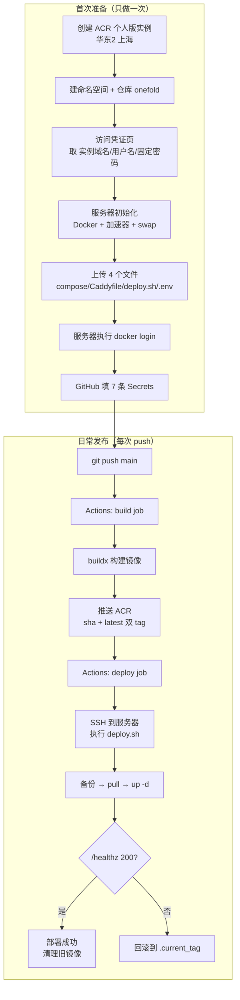
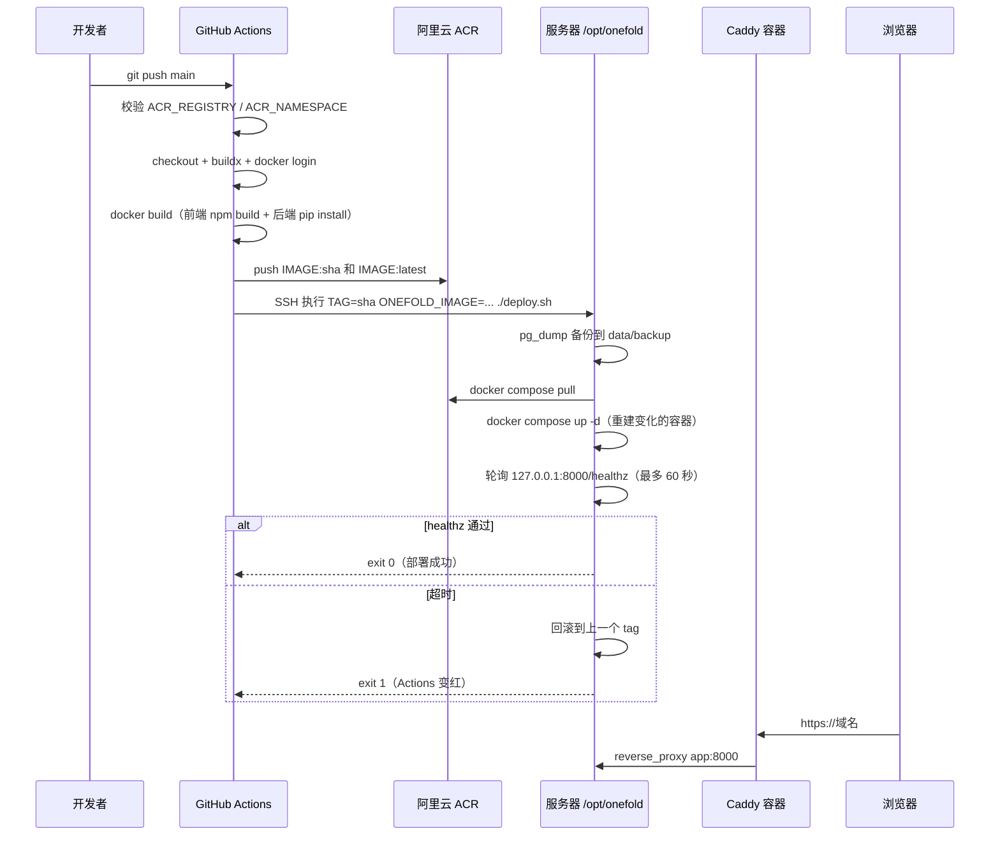
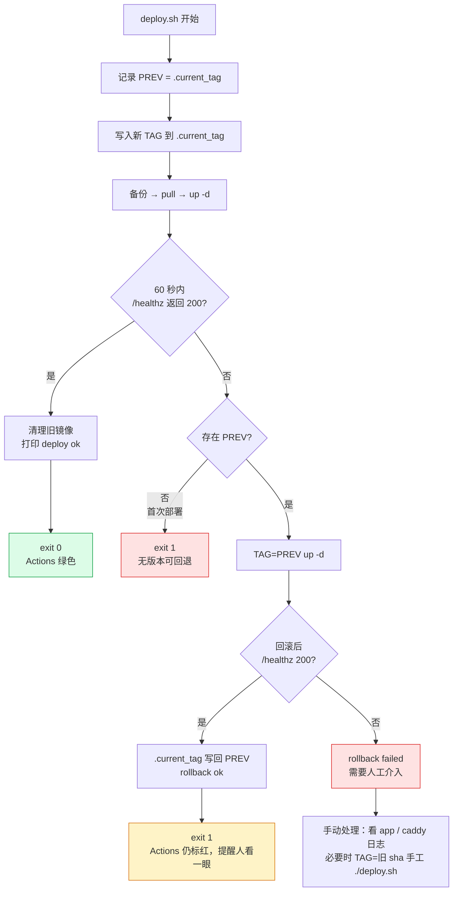
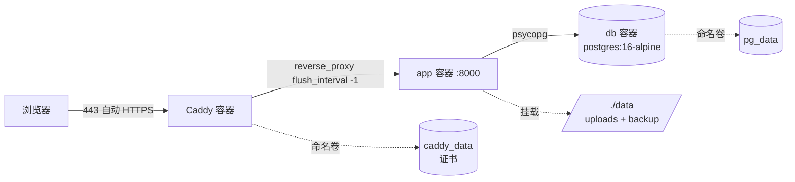

# Onefold 部署全流程：从 ACR 到上线

这篇文档按「实际做过一遍」的顺序，把整套部署链路拆开讲清楚：**阿里云 ACR → 服务器初始化 → GitHub Secrets → 镜像构建 → 自动发布 → HTTPS 上线**，并附上每一步踩过的坑。

> `docs/deploy.md` 是**速查手册**（只看命令），这篇是**原理与流程**（知道为什么）。
>
> 文中服务器 IP、ACR 实例域名、命名空间等一律用占位符，实际值见你自己的私密记录，不要提交到仓库（本仓库是 PUBLIC）。

---

## 0. 全景图

### 0.1 两条时间线

**首次准备**只做一次，**日常发布**是之后每次 push 自动完成：



### 0.2 一次 push 的完整时序



---

## 1. 前置条件

| 项 | 本次实际值 | 说明 |
|---|---|---|
| 服务器 | 阿里云轻量应用服务器，Ubuntu 24.04，1.6G 内存 / 40G 磁盘 | 内存小，**不能在服务器上构建镜像** |
| 域名 | 已备案，A 记录指向服务器 IP | 未备案国内无法用 80/443 |
| 镜像仓库 | 阿里云 ACR **个人版**，华东2（上海） | 免费，够用 |
| 本机 | macOS + `gh` CLI + ssh key | 用来配 Secrets / 传文件 |
| 代码仓库 | GitHub `JXY001A/Onefold`，main 分支 | push 即触发部署 |

---

## 2. 阿里云 ACR：创建与取值

### 2.1 创建实例

1. 进入 [容器镜像服务控制台](https://cr.console.aliyun.com)
2. 左侧「个人版实例」→ **立即开通**（免费）
3. 地域选 **华东2（上海）** —— 一旦开通**不能改地域**，选错只能重建

### 2.2 建命名空间与仓库

| 步骤 | 位置 | 填什么 |
|---|---|---|
| 建命名空间 | 实例内「命名空间」→ 创建 | 全小写，如 `my-team` |
| 建仓库 | 实例内「仓库」→ 创建仓库 | 仓库名 `onefold`，类型选**私有** |

> 仓库不存在时，`docker push` 会报 `denied`，CI 的 build job 会直接失败。

### 2.3 取三样东西（全在「访问凭证」页）

| 要取的 | 长什么样 | 填到哪 |
|---|---|---|
| **实例域名** | `crpi-xxxxxxxx.<region>.personal.cr.aliyuncs.com` | GitHub `ACR_REGISTRY` |
| **用户名** | 页面示例命令里 `--username=` 后面那串（**账号全名**，可能不是邮箱） | GitHub `ACR_USERNAME` |
| **固定密码** | 点「设置固定密码」自己设的那个 | GitHub `ACR_PASSWORD` |

页面会给出一行现成命令，**直接照抄最省事**：

```bash
docker login --username=<这就是用户名> crpi-xxxxxxxx.cn-shanghai.personal.cr.aliyuncs.com
```

### 2.4 新版 vs 旧版：403 的真正原因

阿里云 ACR 个人版现在有两套域名体系：

| 版本 | 域名形态 | 说明 |
|---|---|---|
| 旧版（共享） | `registry.<region>.aliyuncs.com` | 所有账号共用入口 |
| **新版（独立）** | `crpi-xxx.<region>.personal.cr.aliyuncs.com` | 每个实例一个域名 |

用旧地址登录新实例 → **`403 Forbidden`**（不是密码错，密码错是 401）。本次就是卡在这里：地址填了 `registry.cn-shanghai.aliyuncs.com`，用户名密码都对，依然 403。

判断方法：登录成功后看凭据里存的地址。

```bash
docker login <地址> -u <用户名>
python3 -c "import json;print(list(json.load(open('/root/.docker/config.json'))['auths']))"
```

### 2.5 登录必须发生在服务器上

CI 的 deploy job 用 `root` 通过 SSH 执行 `deploy.sh`，里面的 `docker compose pull` 读的是 **服务器上 root 的 `~/.docker/config.json`**。

所以：

- ✅ 在服务器上 `docker login` 一次，长期有效
- ❌ 在自己 Mac 上登录没用（CI 拿不到你的凭据）

---

## 3. 服务器初始化

### 3.1 装 Docker 与 Compose

```bash
curl -fsSL https://get.docker.com | sh
docker --version && docker compose version
```

本次装出来是 Docker 29.10.0 + Compose v5.8.0。

### 3.2 配镜像加速器（国内必做）

国内直连 Docker Hub 会 `connection refused`。先测几个公共加速站，再写进 `/etc/docker/daemon.json`：

```bash
cat > /etc/docker/daemon.json <<'EOF'
{
  "registry-mirrors": [
    "https://docker.m.daocloud.io",
    "https://dockerproxy.net",
    "https://hub.rat.dev"
  ]
}
EOF
systemctl restart docker
docker pull postgres:16-alpine   # 验证
```

### 3.3 加 swap（内存 ≤2G 必做）

```bash
fallocate -l 2G /swapfile && chmod 600 /swapfile
mkswap /swapfile && swapon /swapfile
grep -q '/swapfile' /etc/fstab || echo '/swapfile none swap sw 0 0' >> /etc/fstab
```

### 3.4 目录与四个文件

服务器上固定放在 `/opt/onefold`，与仓库根目录结构一致：

```bash
mkdir -p /opt/onefold
```

从本地传过去（**这四个文件是运行必需的，镜像里没有**）：

```bash
scp docker-compose.yml Caddyfile deploy.sh root@<服务器IP>:/opt/onefold/
scp .env                            root@<服务器IP>:/opt/onefold/
ssh root@<服务器IP> 'chmod +x /opt/onefold/deploy.sh'
```

### 3.5 生成 `.env` 密钥

生产 `.env` 可以直接复制仓库根目录的完整模板再填值：

```bash
cp server.env.example /opt/onefold/.env
chmod 600 /opt/onefold/.env
```

至少确认这些：

```env
ENV=prod
ONEFOLD_DOMAIN=<你的域名>
ONEFOLD_IMAGE=<ACR实例域名>/<命名空间>/onefold
JWT_SECRET=<32 字节随机 hex>
POSTGRES_PASSWORD=<随机串>
COOKIE_SECURE=true
API_KEY=<DeepSeek Key>
OPENROUTER_API_KEY=<OpenRouter Key>
EMBED_BASE_URL=https://openrouter.ai/api/v1
EMBED_MODEL=BAAI/bge-m3
RERANK_ENABLED=true
RERANK_MODEL=mongodb/rerank-3-lite
RAG_ENABLED=true
SEARCH_ENABLED=true
SMTP_HOST=...
GUEST_MAX_ROUNDS=20
```

生成随机值（在服务器上跑，避免密码出现在命令历史里）：

```bash
python3 -c "import secrets; print(secrets.token_hex(32))"        # JWT_SECRET
python3 -c "import secrets; print(secrets.token_urlsafe(18))"    # POSTGRES_PASSWORD
chmod 600 /opt/onefold/.env
```

> `POSTGRES_PASSWORD` 只在**数据卷首次初始化**时生效。之后改它不会改库内密码，需要进容器 `ALTER USER`。

### 3.6 释放 80/443

Caddy 要独占这两个端口。常见占用者：预装的 nginx / apache。

```bash
ss -lntp | grep -E ':(80|443) '
```

如果是遗留 nginx 且上面没有在跑的业务：

```bash
systemctl disable --now nginx
```

### 3.7 自检

```bash
cd /opt/onefold
docker compose config -q && echo compose-ok
docker run --rm -v $PWD/Caddyfile:/etc/caddy/Caddyfile caddy:2 caddy validate --config /etc/caddy/Caddyfile
```

---

## 4. GitHub 仓库配置

### 4.1 七条 Secrets

进 **仓库** → Settings → Secrets and variables → Actions（注意是仓库的 Settings，不是头像里的个人 Settings）。

| 名称 | 值 | 备注 |
|---|---|---|
| `ACR_REGISTRY` | `crpi-xxx.<region>.personal.cr.aliyuncs.com` | **必填**，地址错了会 403 |
| `ACR_NAMESPACE` | `<命名空间>` | 命名空间名 |
| `ACR_USERNAME` | 访问凭证页的账号全名 | **不能带 `****` 掩码**，也不能想当然填登录邮箱 |
| `ACR_PASSWORD` | ACR 固定密码 | 不是阿里云登录密码 |
| `SSH_HOST` | 服务器公网 IP | |
| `SSH_USER` | `root` | |
| `SSH_KEY` | 私钥全文 | 含 `-----BEGIN/END-----` 两行 |

### 4.2 用 gh CLI 一次性配好

```bash
gh secret set ACR_REGISTRY  -b 'crpi-xxx.cn-shanghai.personal.cr.aliyuncs.com'
gh secret set ACR_NAMESPACE -b '<命名空间>'
gh secret set ACR_USERNAME  -b '<账号全名>'
gh secret set ACR_PASSWORD  -b '<固定密码>'
gh secret set SSH_HOST      -b '<服务器IP>'
gh secret set SSH_USER      -b 'root'
gh secret set SSH_KEY       < ~/.ssh/id_ed25519
```

校验：

```bash
gh secret list          # 只要列出 7 条名称，看不到值才是正常的
```

> `workflow` 里同时兼容 `vars.X || secrets.X`，所以填在 Variables 页签也能跑；但密码类只能放 Secrets。

### 4.3 为什么 CI 登录会 `unauthorized`

`docker/login-action` 报 `Get "https://xxx/v2/": unauthorized` 只有两种可能：

1. `ACR_USERNAME` 不是**账号全名**（例如填了带掩码的邮箱）
2. `ACR_PASSWORD` 不是当前的固定密码

最快的核对方式：在服务器上登录成功后，把凭据里的用户名解出来比对（密码只能重设）。

```bash
python3 -c "import json,base64;a=json.load(open('/root/.docker/config.json'))['auths'];[print(base64.b64decode(v['auth']).decode().split(':',1)[0]) for v in a.values()]"
```

---

## 5. 构建：Dockerfile

```dockerfile
# 1) 构建前端
FROM node:20-slim AS web
WORKDIR /web
COPY frontend/package*.json ./
RUN npm ci
COPY frontend/ ./
RUN npm run build

# 2) 运行后端
FROM python:3.12-slim
WORKDIR /app
COPY backend/requirements.txt .
RUN pip install --no-cache-dir -r requirements.txt
COPY backend/app ./app
COPY --from=web /web/dist ./static   # 前端产物塞进后端的 static/
RUN useradd -m -u 10001 appuser && chown -R appuser:appuser /app
USER appuser
EXPOSE 8000
HEALTHCHECK CMD python -c "import urllib.request; urllib.request.urlopen('http://127.0.0.1:8000/healthz')" || exit 1
CMD ["uvicorn", "app.main:app", "--host", "0.0.0.0", "--port", "8000"]
```

三个关键点：

| 设计 | 原因 |
|---|---|
| 前后端同一个镜像 | 后端 `main.py` 把 `static/` 挂在 `/`，一个容器同时提供 API 和页面，Caddy 只反代一个上游 |
| **不在服务器构建** | 服务器 1.6G 内存，`npm build` + `pip install` 必 OOM；构建全在 GitHub 的 ubuntu-latest 上跑 |
| `useradd -u 10001 appuser` | 非 root 运行；所以挂载目录的属主必须是 10001，否则写 `/data` 报 `PermissionError`（见 7.2） |

> `python:3.12-slim` 里**没有 g++**：任何需要源码编译的依赖（如 `hnswlib`）都会在 `pip install` 阶段失败。要么移除该依赖，要么改多阶段构建装 `build-essential`。

---

## 6. CI：`.github/workflows/deploy.yml`

### 6.1 触发与并发

```yaml
on:
  push:
    branches: [main]
    paths-ignore:            # 纯文档改动不进镜像，跳过构建与部署
      - 'docs/**'
      - '**.md'
  workflow_dispatch: {}      # 修完服务器配置可直接手动重跑，不用空提交

concurrency:
  group: deploy-main
  cancel-in-progress: false  # 排队而不是取消，避免两次 push 的镜像互相覆盖

jobs:
  build:
    if: github.ref == 'refs/heads/main'   # 手动触发误选其他分支时不构建不部署
```

**会触发**：push 到 `main`（含网页编辑提交、PR 合并）、Actions 页手动 Run workflow（限 main）。
**不会触发**：push 其他分支、开/更 PR、push tag、纯文档改动（`docs/**`、`**.md`）。

> `paths-ignore` 是「全部命中才跳过」：同一次 push 里只要有一个非文档文件，依旧正常部署。
>
> `main` 默认没有分支保护，误 push 会直接上线。想更稳可以在 Settings → Branches 开启「Require a pull request before merging」，或给 `deploy` job 挂一个 Environment 要求人工 Approve 后才执行。

### 6.2 镜像地址注入

```yaml
env:
  REGISTRY: ${{ vars.ACR_REGISTRY || secrets.ACR_REGISTRY }}
  NAMESPACE: ${{ vars.ACR_NAMESPACE || secrets.ACR_NAMESPACE }}
  IMAGE: ${{ vars.ACR_REGISTRY || secrets.ACR_REGISTRY }}/${{ vars.ACR_NAMESPACE || secrets.ACR_NAMESPACE }}/onefold
```

**这里刻意不写默认值**：写默认值 `registry.cn-shanghai.aliyuncs.com` 时，一旦 Secrets 漏配，CI 会安静地推到错误地址，deploy 阶段 pull 失败还可能被 `|| true` 吞掉 —— 表面绿色、线上没变。宁可让校验 step 直接红。

### 6.3 校验 → 构建 → 推送

```yaml
- name: 校验镜像仓库已配置
  run: |
    missing=""
    [ -n "${{ env.REGISTRY }}" ]  || missing="$missing ACR_REGISTRY"
    [ -n "${{ env.NAMESPACE }}" ] || missing="$missing ACR_NAMESPACE"
    if [ -n "$missing" ]; then
      echo "::error::缺少仓库配置:$missing"
      exit 1
    fi

- uses: docker/setup-buildx-action@v3
- uses: docker/login-action@v3
  with:
    registry: ${{ env.REGISTRY }}
    username: ${{ secrets.ACR_USERNAME }}
    password: ${{ secrets.ACR_PASSWORD }}

- uses: docker/build-push-action@v6
  with:
    context: .
    file: ./Dockerfile
    platforms: linux/amd64
    push: true
    provenance: false      # ACR 不认 attestation 清单，见下
    sbom: false
    tags: |
      ${{ env.IMAGE }}:${{ github.sha }}
      ${{ env.IMAGE }}:latest
    cache-from: type=gha   # 层缓存放在 GitHub，第二次构建 40s→26s
    cache-to: type=gha,mode=max
```

**双 tag 的意义**：

| tag | 用途 |
|---|---|
| `:<sha>` | 不可变，回滚时精确指定；`.current_tag` 记的就是它 |
| `:latest` | 方便手工排查时肉眼识别 |

**`provenance: false` / `sbom: false` 的原因**：buildx 默认会给镜像附加一层 attestation（`application/vnd.oci.empty.v1+json`），ACR 不认这个 manifest 类型，push 直接报：

```
denied: unknown manifest class for application/vnd.oci.empty.v1+json
```

### 6.4 deploy job

```yaml
deploy:
  needs: build
  runs-on: ubuntu-latest
  steps:
    - uses: appleboy/ssh-action@v1
      with:
        host: ${{ secrets.SSH_HOST }}
        username: ${{ secrets.SSH_USER }}
        key: ${{ secrets.SSH_KEY }}
        script: |
          cd /opt/onefold
          TAG=${{ github.sha }} ONEFOLD_IMAGE=${{ env.IMAGE }} ./deploy.sh
```

`ONEFOLD_IMAGE` 必须传：compose 里镜像名是 `${ONEFOLD_IMAGE:-onefold}:${TAG:-latest}`，不传就退化成 `onefold:<sha>`，`compose pull` 拉不到，`up -d` 起的是**上一次的旧镜像**，而脚本可能依然认为成功 —— 典型的「部署了但没生效」。

---

## 7. 发布：`deploy.sh` 逐段

### 7.1 变量兜底（手工执行也能跑）

```bash
PREV=$(cat .current_tag 2>/dev/null || echo "")
export TAG=${TAG:-$(cat .current_tag 2>/dev/null || echo latest)}
export ONEFOLD_IMAGE=${ONEFOLD_IMAGE:-$(grep -E '^ONEFOLD_IMAGE=' .env | cut -d= -f2-)}
```

- CI 调用时：`TAG` / `ONEFOLD_IMAGE` 由 workflow 传入
- 手工执行时（例如只改了 `.env`）：从 `.current_tag` 和 `.env` 兜底，直接 `./deploy.sh` 即可

> 不加兜底的话，手工 `docker compose up -d` 会报 `No such image: onefold:latest`，甚至试图本地构建（服务器没有 Dockerfile）。

### 7.2 数据目录属主

```bash
mkdir -p data/backup data/uploads
chown -R 10001:10001 data 2>/dev/null || true
```

容器以 uid 10001 运行，而 `./data` 是宿主机挂载进去的。如果目录属主是 root，容器内创建 `/data/uploads` 会：

```
PermissionError: [Errno 13] Permission denied: '/data/uploads'
```

表现是 app 容器无限重启，`healthz` 永远探不到 —— 每次都自愈比人工 chown 更可靠。

### 7.3 备份

```bash
docker compose exec -T db pg_dump -U onefold onefold > "data/backup/onefold-$(date +%Y%m%d%H%M%S).sql" 2>/dev/null || true
```

每次部署前自动 dump 一份，失败不阻断发布（`|| true`）。备份放在 `data/backup` 而不是 `data/` 根目录 —— 后者会被 `admin.py` 的文件扫描统计进去。

### 7.4 拉取、启动、探活、回滚

```bash
docker compose pull || true
docker compose up -d

for _ in $(seq 1 30); do
  if curl -fsS http://127.0.0.1:8000/healthz >/dev/null; then
    docker image prune -f >/dev/null 2>&1 || true
    echo "deploy ok: ${TAG:-latest}"; exit 0
  fi
  sleep 2
done

echo "healthcheck failed"
[ -n "$PREV" ] && TAG="$PREV" docker compose up -d
exit 1
```

- 探活最多等 **60 秒**（30 次 × 2 秒）
- 失败自动 `TAG=$PREV docker compose up -d` 回滚到上一次，并让 Actions 变红
- `.current_tag` 是回滚锚点，**不要手动删**

### 7.6 回滚决策流程



三个要点：

| 分支 | 含义 | 之后的动作 |
|---|---|---|
| 探活通过 | 新版本正常 | 无需干预；旧镜像被 `image prune` 清掉 |
| 回滚成功 | 新版本有问题，已自动退回上一版 | 去 Actions 看日志找原因，修完重新 push（或手动重跑） |
| 回滚失败 | 上一版也起不来（通常是外部依赖问题：DB 连不上、.env 写错） | 服务不可用，需人工：`docker compose logs app`，修好 `.env` 后 `./deploy.sh` |

> 回滚后 `.current_tag` 会**写回旧版本**，所以「当前线上是哪个版本」始终以它为准；不要用 `latest` 判断。
> 首次部署没有 PREV，探活失败时直接退出（`I` 分支），此时服务本就未对外，无需回滚。


---

## 8. 运行时：三个容器 + Caddy



| 容器 | 端口 | 暴露范围 | 说明 |
|---|---|---|---|
| `caddy` | 80 / 443 | 公网 | 自动签发续期证书，HTTP 308 跳 HTTPS |
| `app` | 8000 | `127.0.0.1:8000` | uvicorn + 静态文件，**不直接对公网** |
| `db` | 5432 | 仅容器网络 | `expose` 不外露 |

### 8.1 Caddyfile

```
{$ONEFOLD_DOMAIN} {
    encode zstd gzip
    reverse_proxy app:8000 {
        flush_interval -1     # SSE 流式输出必须关缓冲
    }
}
```

- `{$ONEFOLD_DOMAIN}` 为空时退化成 `:80`（本地开发），生产在 `.env` 写域名即自动 HTTPS
- 缺 `flush_interval -1` 时，聊天会「憋一大段一次性蹦出来」而不是逐字输出

### 8.2 SPA 回落

前端用 `BrowserRouter`，`/chat`、`/admin` 这些路径磁盘上没有对应文件。后端挂载静态文件时做了 404 回落：

```python
class SPAStaticFiles(StaticFiles):
    async def get_response(self, path, scope):
        try:
            return await super().get_response(path, scope)
        except StarletteHTTPException as exc:
            # API / MCP 的 404 保持原样，不要把接口错误伪装成首页
            if exc.status_code != 404 or path.startswith(("api/", "mcp/")):
                raise
            return await super().get_response("index.html", scope)
```

没有它，直接打开或刷新 `/chat` 会 404。

---

## 9. 首次上线验证清单

```bash
# 1. 健康检查（JSON）
curl https://<域名>/healthz
# {"status":"ok","app":"onefold","env":"prod"}

# 2. HTTP 自动跳 HTTPS
curl -sI http://<域名>/ | head -1        # 308

# 3. 页面与 SPA 路由
curl -sI https://<域名>/       | head -1   # 200
curl -sI https://<域名>/chat   | head -1   # 200
curl -sI https://<域名>/login  | head -1   # 200

# 4. 接口 404 不被回落成首页
curl -s https://<域名>/api/nope            # {"detail":"Not Found"}

# 5. 静态资源 MIME
curl -sI https://<域名>/assets/<hash>.js   # text/javascript
curl -sI https://<域名>/assets/<hash>.css  # text/css
```

服务端全绿后，还需要在服务器上补两件「业务配置」：

```bash
# 建超管（密码用 argon2 生成哈希后插入）
docker compose exec -T db psql -U onefold -d onefold -c "select id,email,role from users;"

# 改完 .env（API_KEY / SMTP_*）后重建容器
cd /opt/onefold && ./deploy.sh
```

---

## 10. 本次踩过的坑（按出现顺序）

| # | 现象 | 根因 | 修复 |
|---|---|---|---|
| 1 | `docker login` 报 403 | 新版个人版是独立域名 `crpi-xxx.<region>.personal.cr.aliyuncs.com`，公用地址对它无效 | 全部配置改用实例专属域名 |
| 2 | CI login `unauthorized` | Secrets 里用户名是**带 `****` 掩码的邮箱**、密码是旧的 | 从服务器凭据同步真实用户名；密码重设 |
| 3 | `pip install` 失败：`Unsupported compiler -- at least C++11 support is needed` | `hnswlib` 无 py3.12 wheel，slim 镜像无 g++ | 移除未使用依赖（代码里只有 TODO 注释） |
| 4 | push 报 `unknown manifest class for application/vnd.oci.empty.v1+json` | buildx 默认附加 attestation 清单，ACR 不支持 | `provenance: false` + `sbom: false` |
| 5 | Caddy 起不来：`failed to bind host port 0.0.0.0:80: address already in use` | 服务器上有遗留 nginx，反代到早已停止的 9400 | `systemctl disable --now nginx` |
| 6 | app 容器反复重启：`PermissionError: '/data/uploads'` | 挂载目录属 root，容器内是 uid 10001 | `deploy.sh` 自动 `chown -R 10001:10001 data` |
| 7 | 手工 `docker compose up -d` 报 `No such image: onefold:latest` | 镜像名依赖 `ONEFOLD_IMAGE` 变量，手工执行未传 | `deploy.sh` 从 `.env` 兜底；并把 `ONEFOLD_IMAGE` 写进 `.env` |

### 已知行为：部署窗口内的瞬时错误

重建 `app` 容器的几秒里，请求可能拿到 308 / 502。这是正常现象，不是故障；连续访问即可恢复。

### 运维提醒：`.ink` 与 `.link` 不是一回事

域名后缀写错时 DNS 完全无解析，浏览器只会显示空白或错误页。核对方式：

```bash
dig +short <域名> A     # 应返回服务器 IP
```

---

## 11. 日常运维

| 操作 | 命令 |
|---|---|
| 发版 | `git push` 到 main，或 Actions 页面 `Run workflow` |
| 状态 | `cd /opt/onefold && docker compose ps` |
| 应用日志 | `docker compose logs -f --tail=200 app` |
| Caddy 日志（证书） | `docker compose logs -f --tail=200 caddy` |
| **改了 `.env`** | `./deploy.sh`（必须重建容器，`restart` 不重读 env） |
| 手工回滚 | `TAG=<上一个 sha> ONEFOLD_IMAGE=<镜像名> ./deploy.sh` |
| 当前版本 | `cat .current_tag` |
| 备份文件 | `ls -lh data/backup/` |
| 进数据库 | `docker compose exec db psql -U onefold -d onefold` |

### 数据备份与恢复

`deploy.sh` 每次发布前会自动 `pg_dump` 一份到 `data/backup/`。下面是完整链路：

```mermaid
sequenceDiagram
    participant T as 触发方<br/>(deploy.sh / cron)
    participant S as 宿主机 /opt/onefold
    participant D as db 容器
    participant O as 异地存储（可选）

    Note over T,D: 备份
    T->>D: docker compose exec -T db pg_dump -U onefold onefold
    D-->>S: SQL 流（stdout）
    S->>S: 写入 data/backup/onefold-YYYYmmddHHMMSS.sql
    S->>O: 可选：scp / 对象存储上传

    Note over T,D: 恢复
    T->>D: DROP SCHEMA public CASCADE; CREATE SCHEMA public;
    T->>D: psql < data/backup/xxx.sql
    D-->>T: 导入完成
    T->>T: 重启 app（必要时）
    T->>T: curl /healthz 验证
```

**自动备份已有**：每次 `./deploy.sh` 都会在发布前 dump 一份（失败不阻断发布）。

**只靠部署时备份不够**：没人发布就不会有备份。建议加一条 cron：

```bash
# 每天 03:20 备份并 gzip，保留 14 天
20 3 * * * cd /opt/onefold && docker compose exec -T db pg_dump -U onefold onefold | gzip > data/backup/daily-$(date +\%F).sql.gz
30 3 * * * find /opt/onefold/data/backup -name 'daily-*.sql.gz' -mtime +14 -delete
```

**恢复步骤**（先停写，避免边导边写）：

```bash
cd /opt/onefold
docker compose stop app

# 清空现有 schema（保留库本身，权限不变）
docker compose exec -T db psql -U onefold -d onefold -c 'DROP SCHEMA public CASCADE; CREATE SCHEMA public;'

# 导入（gz 包先解压）
docker compose exec -T db psql -U onefold -d onefold < data/backup/onefold-20261119120000.sql

# 起服务并验证
docker compose start app
curl -fsS http://127.0.0.1:8000/healthz
```

| 注意点 | 说明 |
|---|---|
| 先 `stop app` | 恢复期间不接新请求，避免写入冲突 |
| 用 `DROP SCHEMA` 而不是 `DROP DATABASE` | 后者要先断开所有连接，还容易撞权限 |
| 备份目录不要放 `data/` 根 | `admin.py` 会扫描 `data/` 做统计，`backup/` 子目录已排除 |
| 恢复后核对表结构 | `init_db()` 用 `create_all`，**只建表不加列**；跨版本恢复时如需新列要手动 `ALTER TABLE` |
| 异地副本 | 单机备份挡不住磁盘损坏，重要数据建议再 `scp` 或传到对象存储 |

### 排错速查

| 症状 | 先看哪里 |
|---|---|
| Actions 红在 login | `ACR_REGISTRY` 地址、`ACR_USERNAME` 是否账号全名、密码是否固定密码 |
| Actions 红在 build | 依赖是否需要编译（slim 无 g++）、Dockerfile COPY 路径 |
| Actions 红在 push | 仓库是否已创建、`provenance/sbom` 是否关闭 |
| Actions 绿但线上没变 | SSH 是否传了 `ONEFOLD_IMAGE`；`docker compose ps` 看 app 的 tag |
| 502 / 证书错误 | `dig` 域名解析、80/443 是否放行、caddy 日志里的 ACME 报错 |
| 页面白屏 | F12 Network：`/assets/*.js` 是否 404、MIME 是否 `text/javascript`；强刷清缓存 |
| 聊天不流式 | Caddyfile 是否保留了 `flush_interval -1` |

---

## 12. 安全清单（PUBLIC 仓库适用）

| 项 | 做法 |
|---|---|
| `.env` | 已在 `.gitignore`，且 Gitleaks 会在提交前扫描 |
| 密码 / Key / 私钥 | 只进 GitHub Secrets，文档与聊天里一律用占位符 |
| 服务器 IP、ACR 实例域名 | 不写进仓库文档（本文全用 `<服务器IP>` 这类占位符） |
| 凭据外泄后 | ACR 改固定密码、DeepSeek 控制台吊销重建 Key；改完同步 Secrets 与服务器 |
| 数据库密码 | 只在卷首次初始化生效，改它需要进容器 `ALTER USER` |

---

## 附：本文涉及的文件

| 文件 | 作用 |
|---|---|
| `Dockerfile` | 前后端一体镜像（前端产物进 `static/`） |
| `docker-compose.yml` | app / db / caddy 三容器编排 |
| `Caddyfile` | 域名与反向代理（含 SSE 关缓冲） |
| `deploy.sh` | 服务器侧发布脚本（备份 → 拉取 → 探活 → 回滚） |
| `.github/workflows/deploy.yml` | 构建并推送 ACR，再 SSH 触发发布 |
| `docs/deploy.md` | 同类内容的**命令速查版** |
| `backend/app/main.py` | 静态挂载 + SPA 回落 |
